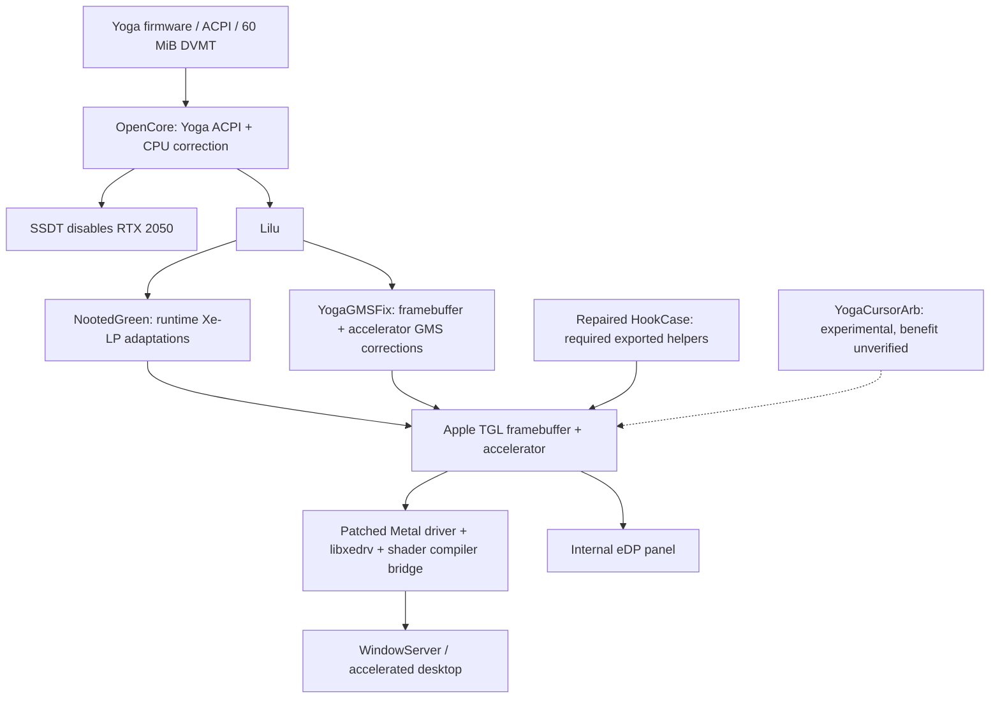
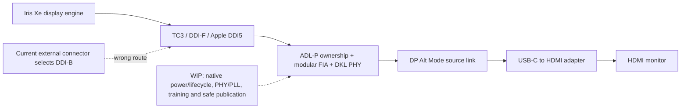

# Lenovo Yoga 82UT — Iris Xe on macOS Tahoe

**Working Iris Xe acceleration + ongoing Yoga development · 24 October 2026**

I'm **Willy Patootie ([@willyyypatootieee](https://github.com/willyyypatootieee))**,
and this is my Lenovo Yoga 82UT setup. **I've confirmed working Iris Xe
acceleration on my laptop.** I'm sharing my working EFI, graphics installation
files and ongoing development here.

**Still WIP:** USB-C → HDMI does not work, and I haven't resolved GPU hangs,
browser lag or cursor corruption. Working acceleration does not mean the whole
setup is stable.

## Installation

Start with **[the Yoga installation guide](readme.md)**. It covers the matching
EFI and GPU files, checksum verification, the v2 installer / v3 HookCase repair
sequence, reboot checks and rollback. **EFI alone is not enough for acceleration.**

Use the Yoga EFI from [`EFI/`](EFI/), not the Dell reference or the experimental
WhateverXe tree. The preserved installers are tied to **Tahoe build 25G241 and
my original external installation**; a clean install on a reformatted disk needs
its target guards reviewed first. I haven't validated that fresh-install path.

## Huge thanks to JulioNectar

**The main foundation is [JulioNectar / Hackintosh-XPS13Plus-IrisXe-Tahoe](https://github.com/JulioNectar/Hackintosh-XPS13Plus-IrisXe-Tahoe).**
Thank you for the NootedGreen integration, HookCase work, Tahoe userspace and
compiler adapters, source, tools and extensive documentation. This Yoga work
builds on that project; it does not claim to have created the original stack.
The original Dell configuration is preserved under
[`reference/Dell-XPS13Plus/`](reference/Dell-XPS13Plus/), **not** presented as Yoga support.

## Hardware

| Component | This machine |
|---|---|
| Laptop | Lenovo Yoga, machine type **82UT** |
| BIOS | **KRCN27WW** |
| CPU | Intel Core **i7-12700H**, Alder Lake-P family 6/model `0x9a` |
| iGPU | Intel Iris Xe **8086:46A6**, revision `0x0c`, **96 EU / 6 DSS** |
| dGPU | NVIDIA RTX 2050 **10DE:25A9**, disabled through Yoga-specific ACPI; no macOS acceleration |
| Panel | CSOT MNE007ZA1-3, **2880 × 1800 @ 90 Hz** |
| Audio | Realtek ALC257, AppleALC layout **11** + SimpleHDA |
| Current macOS target | Tahoe **26.7.1 / 25G241**, external USB SSD |

Do not use `ngreen-eu=80` on this 96-EU configuration. Do not copy a Dell EFI or
spoof this device into a supported WhateverXe family to bypass hardware guards.

## What works — and what does not

| Area | Snapshot status |
|---|---|
| macOS boot and desktop | **Working** with the captured Yoga OpenCore setup |
| Iris Xe acceleration | **Working on my Yoga**; I have confirmed acceleration, not complete stability |
| Built-in display | **Working**; native timing is 2880×1800@90; the saved desktop can use a lower source resolution |
| 60 MiB stolen-memory handling | **Both framebuffer and accelerator runtime corrections verified in captured boot logs** |
| CPU boot/topology correction | Deployed Yoga CPUID/topology setup retained; exhaustive scheduling validation not claimed |
| Keyboard / trackpad / touchscreen | Existing Yoga peripheral setup retained; I2C polling remains enabled; no full gesture/pen certification |
| Audio | AppleALC + SimpleHDA deployed and devices captured; speaker/headphone/microphone coverage is not fully validated |
| Wi-Fi / Bluetooth | Existing kext configuration retained; no complete connectivity/continuity test matrix |
| RTX 2050 | **Disabled**, not supported for acceleration |
| USB-C → HDMI monitor | **Not working — WIP** |
| Cursor corruption / stripes | **Unresolved**; reversible YogaCursorArb trial deployed, benefit unverified |
| GPU hangs / browser lag | **Unresolved**; BCS hangs captured; no proven stability fix |
| System sleep / wake | **Not validated** |
| AirDrop / DRM / hardware video codecs / camera / fingerprint | **Not certified on this Yoga**; Dell upstream results do not imply Yoga support |

## How the working graphics path fits together

EFI alone is **not** the complete graphics installation. The matching driver,
HookCase and userspace files must also be installed in macOS. The existing
GPU installer and targeted HookCase repair are preserved, with their
original checks and restore paths; see [reinstall / recovery](docs/yoga/RECOVERY.md).

## Why USB-C → HDMI is still WIP

Linux establishes the physical route. The adapter receives **DisplayPort**, so
native-HDMI coefficients are not the source-link fix. WhateverXe provides real
tested Tiger Lake DP-alt reference code, but upstream ADL-P support is incomplete.
Our tests and cross-compiled objects are **not a loadable or working HDMI repair**.
See [WIP progress](docs/yoga/WIP.md).

## Files and backups

| Path | Purpose |
|---|---|
| [`EFI/`](EFI/) | Active Yoga EFI snapshot; **SMBIOS serial/MLB/UUID/ROM removed** |
| [`docs/yoga/`](docs/yoga/) | Recovery instructions, progress, hashes and provenance |
| [`macos/yoga-installer/`](macos/yoga-installer/) | GPU installer scripts, targeted HookCase repair and repaired HookCase bundle |
| [`research/yoga/`](research/yoga/) | GMS/cursor source, native Type-C WIP, build scripts, tests and audits |
| [`research/WhateverXe-ADLP/`](research/WhateverXe-ADLP/) | Local ADL-P development source snapshot, **not deployed** |
| [`firmware/yoga-82UT/`](firmware/yoga-82UT/) | Reviewed ACPI/VBT/OpRegion research capture; **not a flashable BIOS** |
| [`reference/`](reference/) | Upstream Dell EFI/documentation, separate from Yoga |
| [`src/`](src/), [`macos/`](macos/), [`tools/`](tools/) | Inherited upstream implementation; upstream instructions are not automatic Yoga reinstall instructions |

Download archives from **[Releases](../../releases)**. Keep the archives and
checksums on a second disk before reinstalling Linux or macOS. Public EFI must
receive your **own** SMBIOS identity before booting; do not copy another person's
serials. The exact unsanitized backup remains private/local and is not published.

The old Dell `install.sh` / `make-efi.sh` flow is **not** the restore procedure
for this snapshot. In particular, do not regenerate the EFI and lose Yoga ACPI,
GMS fixes, CPU correction or peripheral configuration.

## Safety

- This snapshot is experimental. Keep a second bootable EFI and a backup of your data.
- No guarantee that a clean reinstall works identically; installer partition
  identity guards intentionally reject a newly formatted target until reviewed.
- Do not treat raw BIOS dumps as safe to flash. No BIOS/register writes are part
  of this repository's firmware research instructions.
- The archived deployment scripts contain machine-specific assumptions and are
  **research code**, not one-click general installers.
- Release assets are recovery artifacts, not evidence of stability. Read the
  release notes and check SHA-256 before using them.

## Credits and licensing

### Contributors

- **[Willy Patootie — @willyyypatootieee](https://github.com/willyyypatootieee)** —
  Lenovo Yoga port, working-acceleration testing, EFI integration and Yoga-specific
  GMS/cursor/Type-C development, recovery files and documentation.
- **[JulioNectar](https://github.com/JulioNectar)** — original Dell project and the
  graphics-stack foundation this Yoga port builds on.

See also [CONTRIBUTORS.md](CONTRIBUTORS.md).

### Upstream credits

- **[JulioNectar](https://github.com/JulioNectar/Hackintosh-XPS13Plus-IrisXe-Tahoe)** — main upstream project and the foundation of this port.
- **StezzaPilot / [NootedGreen](https://github.com/sgiammori/NootedGreen)** — original graphics project and driver integration.
- **Steven Michaud / HookCase** — MIT-licensed helper framework; upstream and local fixes preserve its attribution.
- **[b00t0x / WhateverXe](https://github.com/b00t0x/WhateverXe)** and [WhateverXe Graphics](https://github.com/b00t0x/WhateverXe-Graphics), plus jkbuha — graphics/display reference work; not a supported drop-in ADL-P replacement.
- **acidanthera**, OpenIntelWireless, VoodooI2C/VoodooPS2 contributors, USBToolBox,
  YogaSMC contributors and **laobamac / SimpleHDA** — OpenCore and peripheral/audio support.
- **Linux i915 contributors** and Apple XNU source — display, PHY, power and mapping references.

See [LICENSE](LICENSE), [NOTICE.md](NOTICE.md) and retained component licenses.
Third-party firmware and driver binaries retain their original terms; inclusion
in a recovery archive grants no additional redistribution rights. No Apple
installation media, personal DMI dump, OEM product key or raw SPI image is included.
